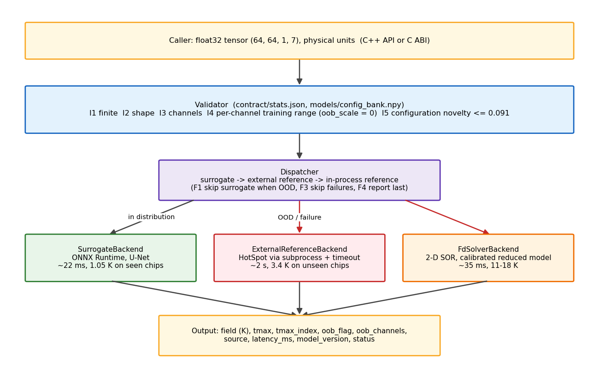
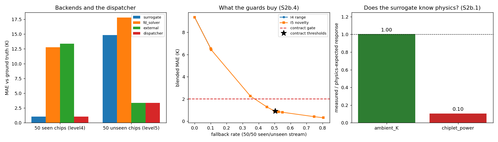
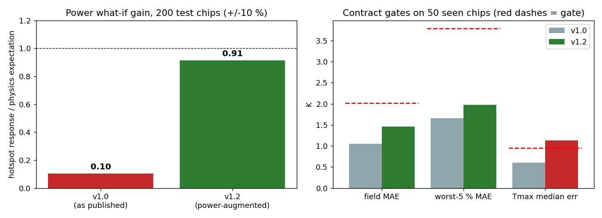

# thermal-surrogate-cpp（中文说明）

[](https://github.com/xingtong-bao/thermal-surrogate-cpp/actions/workflows/ci.yml)


[English README](README.md)

**把一个神经网络热仿真代理模型，做成能放心放进芯片设计工具里的零件。**
仓库以一个公开模型（IC-ThermBench level4 U-Net：7 张输入图 → 64×64 稳态温度场）为对象，围绕它建起并实测了一个产品所需的全部东西：书面接口合同、输入校验、分布外检测、逐预测误差界、自动回退到物理求解器、带发布门槛的"求解器反哺模型"生命周期、C++17 库及 C/Python 接口，以及每一个数字的可复现记录。下文每个数字都链接到保存它的文件。



## 五分钟版本

| 设计探索类产品对代理模型的要求 | 本仓库给出的答案 | 文件 |
|---|---|---|
| **快** | 一张 64×64 温度场 **22–30 ms**（笔记本 CPU）；物理求解器要 2–3 秒 | [latency_single.json](docs/results/latency_single.json) |
| **见过的地方要准** | 50 样本测试子集 MAE **1.05 K**，全部 3000 条 1.83 K（作者公布 1.83 K），复现到 5e-4 K | [baseline_notes.md](docs/results/baseline_notes.md) |
| **知道自己不知道什么** | 6 维配置新颖度检查拒绝 **100%** 的未见芯片、误拒 1%；逐通道范围检查只能抓 20% | [extrapolation_notes.md](docs/results/extrapolation_notes.md) |
| **说得出自己有多确定** | 共形预测**逐预测 90% 误差界**，按设计温度 1.6–3.7 K；留出集覆盖率 1.00 | [conformal_notes.md](docs/results/conformal_notes.md) |
| **绝不给出自信的错误答案** | 调度器：代理 → 外部求解器（HotSpot）→ 进程内求解器；未见芯片 **14.8 K → 3.4 K**；混合流 2.2 K vs 仅代理 7.9 K | [backend_comparison_notes.md](docs/results/backend_comparison_notes.md) |
| **从每次求解器运行中学习** | 每块未见芯片 50 个求解器答案：**17.1 K → 2.8 K**；发布门槛随即抓住了灾难性遗忘（旧芯片 1.05 → 5.8 K），没让它发布 | [lifecycle_notes.md](docs/results/lifecycle_notes.md) |
| **what-if 要答对** | 全芯片功率缩放用物理公式精确回答，增益恰为 1；单芯粒灵敏度用物理增强从 0.1 提到 **0.85**（取舍实测、被门槛把关） | [power_aug_notes.md](docs/results/power_aug_notes.md) |
| **集成与模型无关** | U-Net、U-FNO（FFT 层改写为矩阵乘后导出）及二者集成走同一份合同、校验器和门槛；U-FNO 0.60 K 但 760 ms | [model_swap_notes.md](docs/results/model_swap_notes.md) |
| **工程质量** | 与 Python 导出逐位一致；8 线程 ThreadSanitizer 无告警；38 个测试含合同门槛；Linux CI；C 接口；pybind11 | [parity_cpp.json](docs/results/parity_cpp.json), [concurrency.json](docs/results/concurrency.json) |



**这些结果是否证明 AI 方法行不通？** 不是。它证明的是：这个公开模型在训练分布内可靠、分布外不可靠；边界可以自动检测；分布外由求解器兜底；而分布外会随着产品本来就会生成的数据不断缩小。这正是一个能用的系统应有的形状；本仓库的贡献是量出它的每一条边，并建好把模型关在边界内的机制。

## 模型在哪里停下，以及这对数据提出什么要求

每条局限都经过实测、追溯到训练数据里的原因，并翻译成产品生成数据时的要求。没有一条是方法本身的局限。

| 实测局限 | 数据上的原因 | 对产品的要求 |
|---|---|---|
| 单芯粒功率 what-if：只复现真实热点变化的 0.1–0.3（求解器验证） | 功率只有 14 个离散档位且与版图绑定；模型从没见过"同一芯片、不同功率" | 按芯粒连续采样功率；或用精确的线性响应做数据增强（本仓库已做，增益 0.85） |
| 未见芯片：每个输入都在范围内，误差仍有 14 K | 训练集只有 10 块芯片；模型学会的是十种版图，不是热传导 | 在设计空间上生成数据；每次求解器运行都扩充训练集和新颖度库 |
| 散热 what-if：斜率是求解器的 2 倍 | 同上 | 旋钮变化在数据覆盖之前交给求解器 |
| 热点**位置**：精确命中 3.7% | 最高点附近温度场很平 | 报告温度，不报告格子 |

## 改变了设计的实验（阶段 8）

阶段 8 按设计空间探索产品的视角做了一次复审：每个候选设计都是新的，优化器必须知道何时能信代理。每一项都对应一个脚本、一个结果文件和一份笔记。

1. **用求解器验证物理结论。** 功率灵敏度用 HotSpot 在同样的扰动输入上重测：求解器线性到 0.2%；代理只复现其响应的 0.28（已知芯片）/ 0.08（未见芯片）。[power_gain_verification.json](docs/results/power_gain_verification.json)
2. **逐预测误差界**（共形预测，验证集标定，按预测温升分档；C++/C/Python 都有 `mae_bound_90_K`、`tmax_err_bound_90_K` 字段）。
3. **求解器反哺模型的生命周期。** 用求解器答案微调 → 导出 → 对拍 → 扩充新颖度库 → 重标定误差界 → 门槛。门槛拦下了目前所有候选并说明原因（遗忘；热点门槛差 0.13–0.25 K）。提交的 50 样本子集被证明只是冒烟门槛，全部 3000 条测试集才是发布门槛。

   | 生命周期 | v1.0 | 50 shots | 50 shots + 回放 250 | 功率增强（±15%，早停） |
   |---|---|---|---|---|
   | 未见芯片 MAE | 15.8 K | 2.6 K | 2.8 K | 13.4 K（非其目标） |
   | 功率增益 | 0.10 | — | — | **0.85** |
   | 已知芯片 MAE，门槛 2.01 K（全量集） | 1.83 通过 | 5.8 **不过** | 1.45 通过 | 2.07 **不过** |
   | 已知芯片热点中位误差，门槛 0.95 K | 0.87 通过 | — | 1.19 **不过** | 1.09 **不过** |
   | 结论 | 已发布 | 拦下 | 拦下 | 候选 |

4. **探索循环演示。** 散热扫描代理 0.43 s 对 HotSpot 32.5 s，但斜率是求解器的 2 倍：旋钮变化留给求解器。[exploration_notes.md](docs/results/exploration_notes.md)
5. **功率 what-if 用物理回答。** 热传导对功率线性，`solve_power_scaled` 从基准预测精确推出"所有芯粒功率 × f"。[合同 §9](contract/contract.md)
6. **换模型与集成。** U-FNO 把分布内误差减半但 CPU 成本 25 倍、未见芯片更差；U-Net/U-FNO 的分歧在未见芯片上大 19 倍，是免费的不确定性信号。

   | 模型 | 已知芯片 MAE / 热点中位 | 未见芯片 MAE | 延迟 p50（CPU，4 线程） |
   |---|---|---|---|
   | U-Net（发布版） | 1.05 / 0.60 K | 14.8 K | **30 ms** |
   | U-FNO | **0.60 / 0.27 K** | 24.6 K | 760 ms |
   | 集成 | 0.69 / 0.27 K | 18.4 K | 745 ms |



## 快速开始

```bash
# 依赖：cmake >= 3.24、ninja、C++17 编译器、python3（fixture）、网络（ONNX Runtime 与模型）
git clone https://github.com/xingtong-bao/thermal-surrogate-cpp && cd thermal-surrogate-cpp
gh release download models-v1 --dir models          # model.onnx + model_dynamic.onnx（各 20 MB）
cmake -S . -B build -G Ninja -DCMAKE_BUILD_TYPE=Release
cmake --build build
ctest --test-dir build --output-on-failure        # 38 个测试，约 20 秒
./build/ts_demo --info                            # 运行时版本 + 模型 IO
./build/c_caller models contract tests/fixtures/sample_input.npy   # C 接口示例
```

没有 `gh` 时：从 [models-v1 release](https://github.com/xingtong-bao/thermal-surrogate-cpp/releases/tag/models-v1) 下载两个文件并按 [models/metadata.json](models/metadata.json) 里的 SHA-256 校验，或按 [models/README.md](models/README.md) 重新生成。

## 使用方式

```cpp
#include "thermal_surrogate/dispatcher.h"
#include "thermal_surrogate/fd_solver.h"
using namespace thermal_surrogate;

Validator validator("contract/stats.json", "models/config_bank.npy");
Predictor predictor("models/model.onnx", "models/metadata.json");
std::vector<std::unique_ptr<ISolverBackend>> chain;
chain.push_back(std::make_unique<SurrogateBackend>(predictor));
chain.push_back(std::make_unique<FdSolverBackend>(load_fd_params("models/fd_solver_params.json")));
Dispatcher dispatcher(validator, std::move(chain));
dispatcher.set_conformal(ConformalTable("contract/conformal.json"));   // 可选：误差界

Output out;                                   // 构造之后永不抛异常
dispatcher.solve(Input{data /* 64*64*1*7 个 float */, kInputShape}, out);
if (out.status.ok()) use(out.field, out.tmax, out.mae_bound_90_K, out.source, out.oob_flag);
dispatcher.solve_power_scaled(Input{data, kInputShape}, 1.1, out);   // 所有芯粒功率 +10%，物理精确
```

输入是调用方缓冲区的非拥有视图；输出归调用方（`predict_into` 写入你自己的缓冲区）。C 接口（`ts_c_api.h`，不透明句柄，整数状态码）见 [examples/c_caller.c](examples/c_caller.c)；Python 绑定见 [python/](python/)。所有权、生命周期、线程、错误传播、版本规则见 [docs/integration_design.md](docs/integration_design.md)。

## 合同

[contract/contract.md](contract/contract.md) 是给人读的接口合同；[contract/schema.json](contract/schema.json) 是它的机器可读形式（JSON Schema 2020-12，Python 校验器使用，C++ 枚举与之对齐）；[contract/stats.json](contract/stats.json) 存库读取的全部实测常量；[contract/conformal.json](contract/conformal.json) 是误差界表。合同里最初所有的 `TBD` 都由后续实测回填，从不手填；对拍门槛的三次修订都保留在 §4 作为记录。

| 规则 | 内容 | 违反时 |
|---|---|---|
| I1–I3 | float32、有限值、形状 (64,64,1,7)、7 通道 | 硬拒绝（`InvalidInput`、`ShapeMismatch`、`ChannelMismatch`） |
| I4 | 每个通道在训练范围内（`oob_scale` = 0） | `OutOfDistribution` → 回退 |
| I5 | 配置向量到最近训练芯片的距离 ≤ 0.091 个标准差单位 | `OutOfDistribution` → 回退 |
| F1–F4 | 代理 → 外部参考 → 进程内参考；失败跳过；报告最后一个 | `source` 说明谁回答的 |
| §9 | 全芯片功率缩放用物理回答 | 增益由构造为 1 |

## 结果

**精度**（[baseline_notes.md](docs/results/baseline_notes.md)、[parity_notes.md](docs/results/parity_notes.md)）

| 指标 | 数值 | 文件 |
|---|---|---|
| 基线复现，level4 测试集（3000）：MAE / RMSE / 热点误差 | 1.8293 / 2.5510 / 1.1855 K（作者 1.8291 / 2.5508 / 1.1851） | [baseline_unet_level4.json](docs/results/baseline_unet_level4.json) |
| 合同门槛（基线 × 1.1）：MAE / 最差 5% / 热点中位 | 2.012 / 3.792 / 0.952 K，由 `AccuracyGate.*` 强制 | [baseline_unet_level4_per_sample.json](docs/results/baseline_unet_level4_per_sample.json) |
| PyTorch（单样本）↔ ONNX Runtime，100 样本 | 最大 8.2e-4 K，平均 3.5e-6 K，88.5% 像素逐位相同 | [parity_python.json](docs/results/parity_python.json) |
| ONNX Runtime Python ↔ C++，10 对 | 0 K（逐位相同） | [parity_cpp.json](docs/results/parity_cpp.json) |
| 热点**位置**：argmax 与真值相同 | 3.7% 的样本（仅供参考，不设门槛） | [baseline_unet_level4_per_sample.json](docs/results/baseline_unet_level4_per_sample.json) |

**延迟与吞吐**（Apple M4，4 性能核 + 6 能效核，16 GB，ONNX Runtime 1.23.2 CPU）

| 测量 | 数值 | 文件 |
|---|---|---|
| 单次预测，1 / 4 / 8 线程，p50 | 79.9 / 30.3 / 27.2 ms（p95 80.8 / 33.0 / 34.1） | [latency_single.json](docs/results/latency_single.json) |
| 会话加载 / 首次调用 | 8–30 ms / 21–80 ms | 同上 |
| batch 1 / 8 / 32 / 64，样本每秒 | 48.8 / 33.8 / 34.3 / 34.6（CPU 上批量无收益） | [throughput.json](docs/results/throughput.json) |
| 更大网格：128² / 256² / 512² | 117 ms / 468 ms / 1.87 s，每千格 7.14 ms，512² 占 620 MB | [dynamic_size.csv](docs/results/dynamic_size.csv) |
| 一个会话上 8 线程 × 100 次预测 | 逐位相同，ThreadSanitizer 无告警 | [concurrency.json](docs/results/concurrency.json) |

**参考求解器**（二者都是数据生成器的简化模型；数据集的封装参数未公开）

| 后端 | 已知芯片 MAE | 未见芯片 MAE | 延迟 | 文件 |
|---|---|---|---|---|
| 进程内二维有限差分，4 个标定参数 | 12.8 K | 17.8 K | 34–41 ms | [fd_solver_validation.json](docs/results/fd_solver_validation.json) |
| HotSpot 网格模型（子进程） | 13.4 K | 3.4 K | 2–2.7 s | [hotspot_validation.json](docs/results/hotspot_validation.json) |

**失效分析**：[docs/failure_analysis.md](docs/failure_analysis.md)（一页：可信区域、不可信区域、物理原因），配合 [error_buckets_notes.md](docs/results/error_buckets_notes.md)、[sensitivity_notes.md](docs/results/sensitivity_notes.md) 和 [backend_comparison_notes.md](docs/results/backend_comparison_notes.md)。

## 超出 64×64

导出的图是全卷积的；`model_dynamic.onnx` 可跑任何边长为 8 的倍数的网格。本 CPU 上成本线性：每千格 7.14 ms、约 1.6 MB，百万格网格一次调用约 7.5 秒、2.4 GB。服务这种网格的设计（256 格瓦片 + 32 格光环、输出直接流入调用方缓冲区、超过约 10 万格切到 GPU 执行提供器、按瓦片校验与回退）见 [dynamic_size_notes.md](docs/results/dynamic_size_notes.md)。这是成本测量，不是经过验证的预测。

## 已知局限

- 单芯粒功率变化：发布版模型增益 0.1；增强候选达到 0.85 但被发布门槛拦下（静态精度差 0.2 K）。全芯片缩放由物理精确回答（§9）。
- 规则 I5 在这个基准上实际是模型见过的十种芯片配置的白名单。这是模型的真实边界，不是通用的新颖度检测器；集成分歧提供了第二个不依赖配置库的信号。
- 两个参考求解器都不能复现数据集的生成器（HotSpot 在已知芯片上差 13 K、未见芯片 3.4 K；差分求解器 11–18 K）。它们是物理自洽的兜底，不是真值。
- 热点位置不可复现（精确命中 3.7%）；`tmax_index` 仅供参考。
- 仅 CPU 执行提供器；`cmake/onnxruntime.cmake` 已接入 macOS arm64 和 Linux x64 的预编译运行时。

## 复现每一个数字

| 步骤 | 命令 | 产物 |
|---|---|---|
| 拉取数据与权重（HTTP Range 抽取，约 250 MB 而非 46.8 GB） | `python tools/fetch_assets.py [--checkpoint-members level4_UNet/,level4_UFNO/]` | `docs/results/data_manifest.json` |
| 基线复现 | `tools/run_baseline.sh --device cpu`；`tools/baseline_per_sample.py` | `baseline_*.json` |
| 训练统计量、fixture | `python tools/export_stats.py --bench ../external/ThermalBench` | `contract/stats.json`、fixture |
| 敏感性、误差分桶、外推、新颖度、回退曲线 | `tools/sensitivity.py`、`error_buckets.py`、`extrapolation.py`、`layout_novelty.py`、`fallback_curve.py` | `docs/results/*` |
| ONNX 导出与对拍 | `python tools/export_onnx.py`；`python tools/parity_check.py`；`tools/export_ufno_onnx.py`；`tools/export_ensemble_onnx.py` | `models*/`、`parity_python.json`、`tests/fixtures/parity/` |
| C++ 对拍、延迟、吞吐、尺寸 | `ts_demo --parity`、`bench_latency`、`bench_throughput`、`bench_dynamic_size` | `parity_cpp.json`、`latency_*.json`、`throughput.json`、`dynamic_size.csv` |
| 参考求解器、后端对比 | `ts_demo --fd-calibrate` / `--fd-validate`；`ts_demo --compare ... python tools/reference_cli.py` | `fd_solver_*.json`、`backend_comparison*.csv` |
| 误差界、求解器验证增益、探索演示 | `tools/conformal.py`、`tools/power_gain_verification.py`、`tools/exploration_demo.py` | `contract/conformal.json`、`power_gain_*.json`、`exploration_demo.*` |
| 生命周期（few-shot、功率增强） | `tools/finetune_fewshot.py` + `tools/lifecycle_v11.py`；`tools/finetune_power_aug.py` + `tools/lifecycle_poweraug.py` | `lifecycle_*.json`、`power_aug_*.json`、`models_v1.*/` |
| TSan 并发 | `cmake -B build-tsan -DTS_SANITIZE=thread && ./build-tsan/ts_tests --gtest_filter='Concurrency.*'` | `concurrency.json` |

Python 工具需要 IC-ThermBench 检出在本仓库旁边（`../external/ThermalBench`）及其 Python 环境（3.10、torch 2.0.1、onnxruntime 1.23.2）；C++ 侧只需要 CMake 和下载钉死版本的 ONNX Runtime 包的网络。

## 测试

`ctest` 运行 38 个测试：`Skeleton.*`（运行时与模型 IO 符合合同）、`Predictor.*`（构造、无异常拒绝、与 Python 运行时对拍、零拷贝与批量路径）、`Validator.*`（每个状态码、两个 fixture、特征提取与 Python 一致）、`Fixture.*`（调度器规则 F1–F4，脚本后端）、`FdSolver.*`（收敛、环境温度精确平移、功率增益 1、回退）、`ExternalBackend.*`（协议、退出码、超时杀进程）、`Concurrency.*`、`AccuracyGate.*`（提交子集上的合同门槛；状态码拼写与 schema 一致）、`Conformal.*`（误差界加载、随温升变宽、覆盖留出集）、`PowerWhatIf.*`（物理缩放 what-if 增益恰为 1）。

## 目录

```
contract/        contract.md, schema.json, stats.json, conformal.json   接口及其实测常量
include/, src/   Predictor, Validator, Dispatcher（+ ConformalTable, 功率 what-if）, 差分求解器, 外部后端, C 接口
apps/ts_demo     --info --parity --fd-calibrate --fd-validate --compare
bench/           延迟、吞吐、动态尺寸
tests/           GoogleTest 套件 + fixture（对拍样本对、eval50 子集、校验器期望值）
tools/           Python：数据拉取、基线、统计、分析、导出、对拍、HotSpot 包装、生命周期
python/          pybind11 模块 + 检查脚本
models/          metadata.json, config_bank.npy, fd_solver_params.json（ONNX 文件走 release）
models_v1.1_*/, models_v1.2_*/, models_ufno/, models_ensemble/   候选版本各自的元数据、配置库、误差界表
docs/results/    每一个实测数字及笔记；docs/failure_analysis.md；docs/integration_design.md
```

## 许可与致谢

代码：MIT（[LICENSE](LICENSE)）。模型权重与数据：IC-ThermBench（CC BY 4.0），未作修改；导出的 ONNX 文件是其发布的 level4 U-Net 与 U-FNO 权重的衍生品。HotSpot 作为外部工具按其自身许可使用。ONNX Runtime 使用微软的预编译包。
